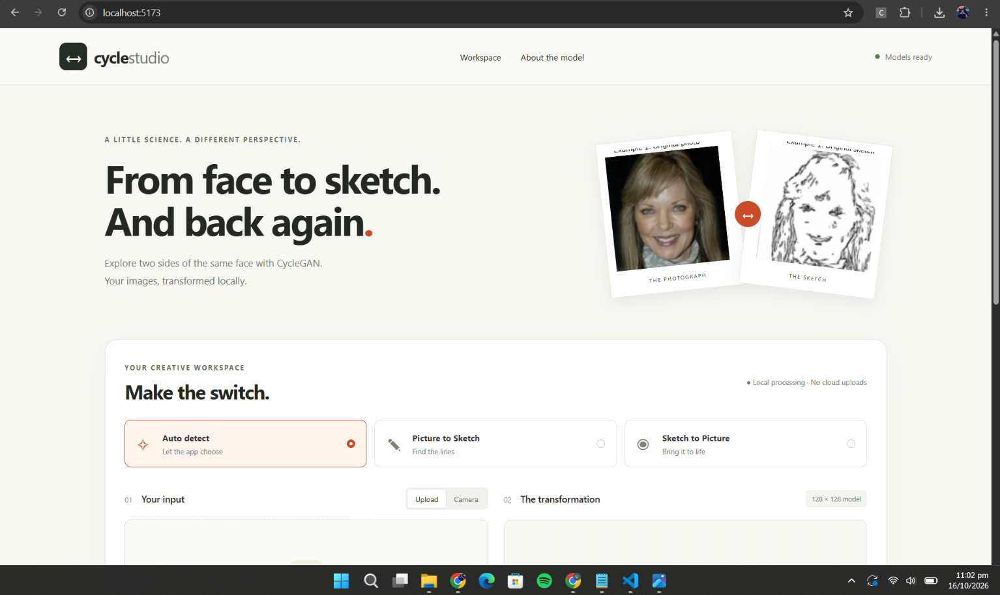
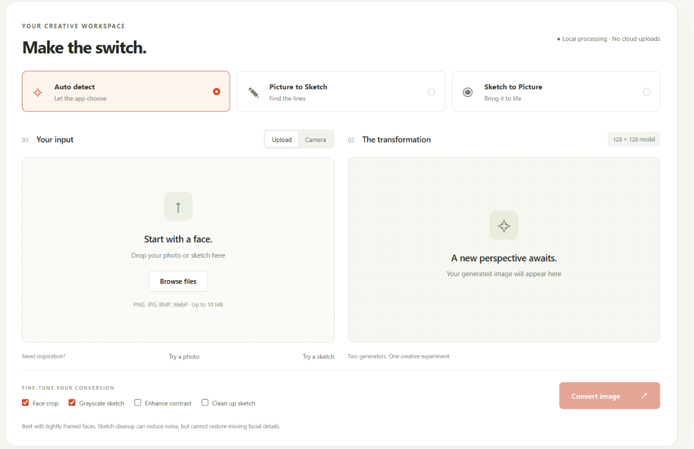
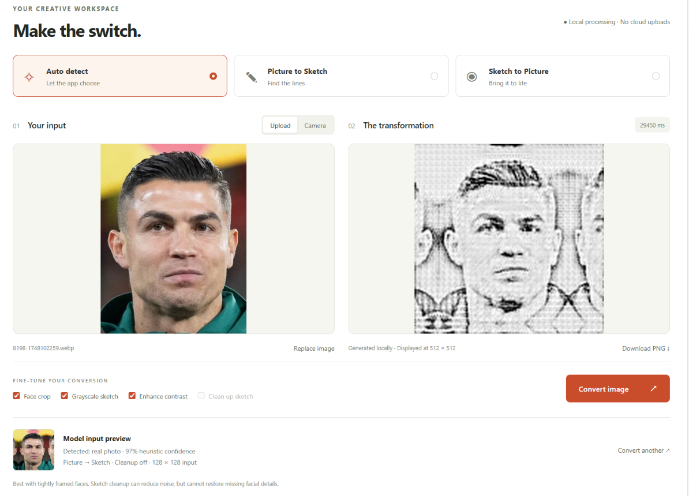
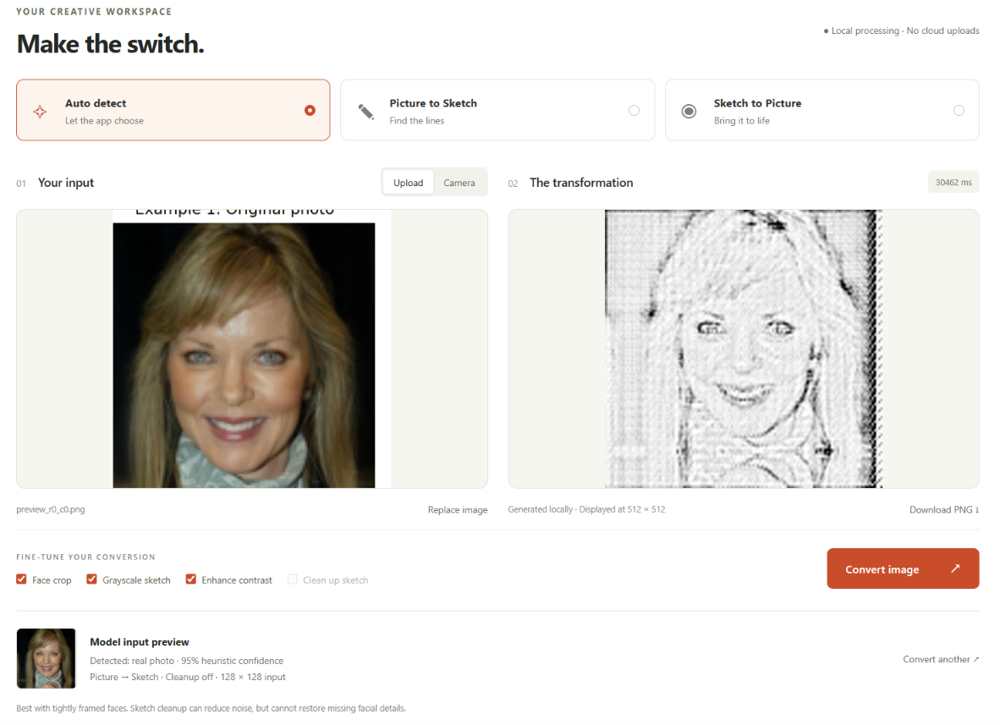
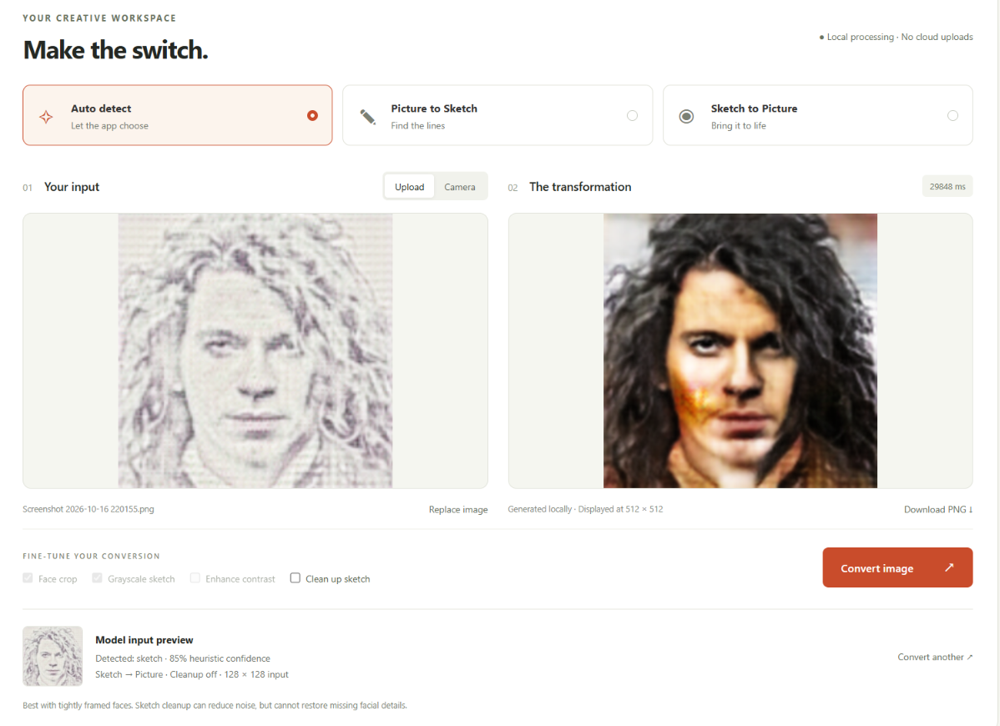
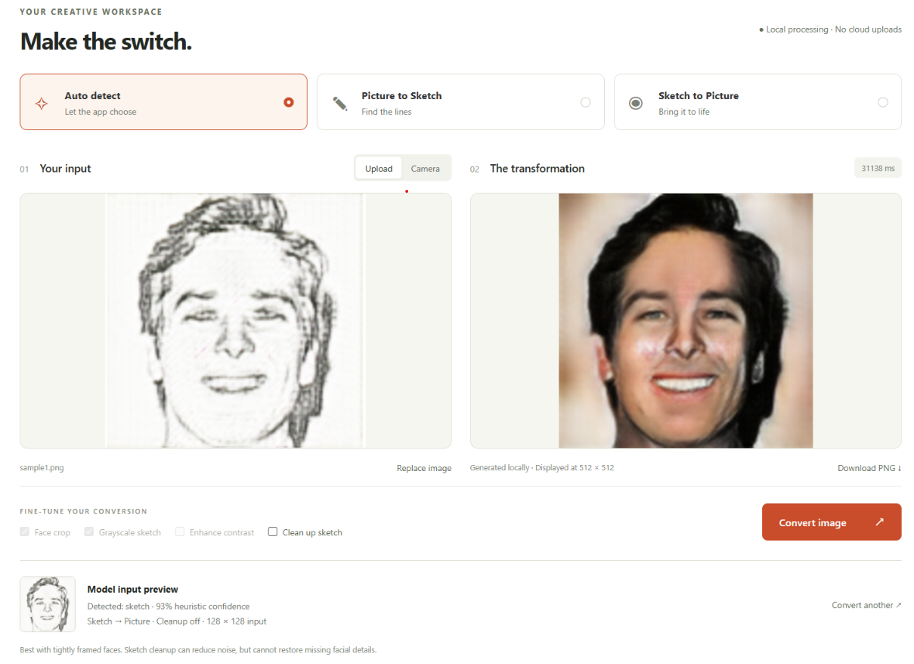
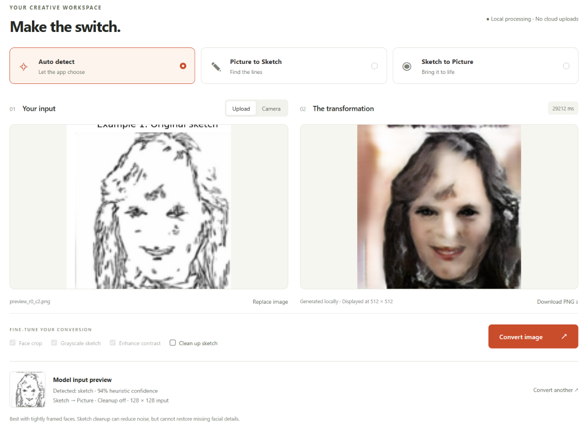
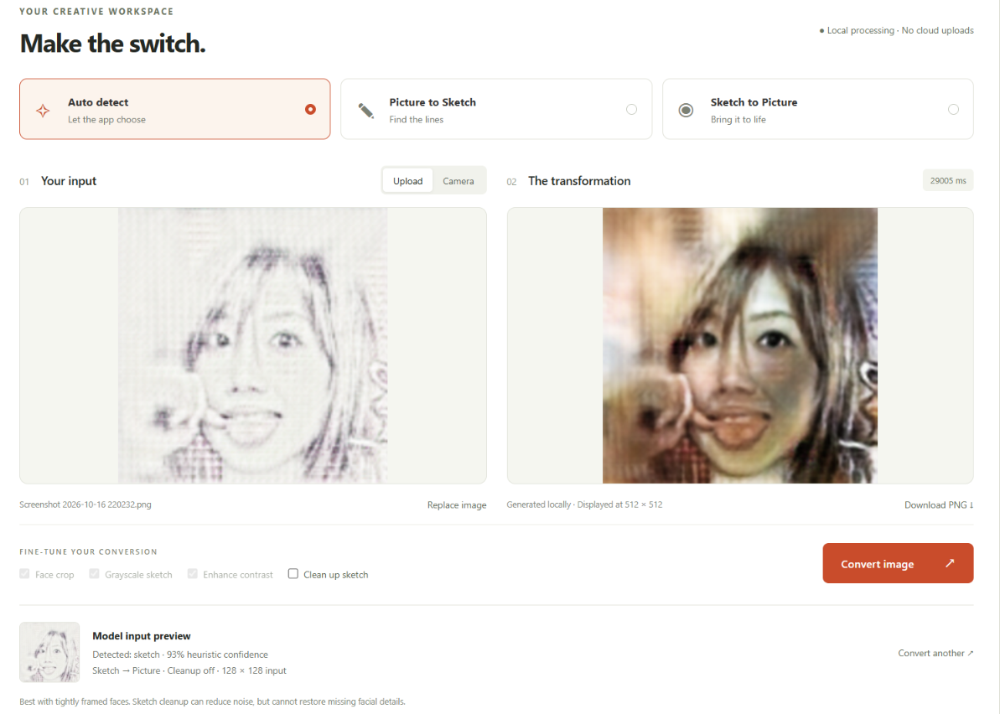

# FlipArt

FlipArt converts face photographs into pencil sketches and sketches into face photographs with trained CycleGAN generators. The React + TypeScript frontend talks to a local Flask API running TensorFlow inference.

**Created by Uzair Majeed and Faez Ahmed.**

## Pre-trained Model Weights

Download the pre-trained CycleGAN generator weights directly from HuggingFace:

* **[HuggingFace Model Repository (uzairdot/Cycle-GAN-Sketch-to-Image)](https://huggingface.co/uzairdot/Cycle-GAN-Sketch-to-Image/tree/main)**

## Features

* Upload or drag and drop PNG, JPG, BMP, and WebP images up to 10 MB.

* Capture photos with a webcam, preview them, and retake them.

* Detect the input type automatically or choose the direction manually.

* Preview the prepared input, crop faces, clean up sketches, and adjust sketch output.

* Download results as PNG files. Images are processed locally.

The ResNet-6 generators operate at 128 x 128 pixels. Results are enlarged to 512 x 512 for display and download; tightly framed faces similar to the training data work best.

## Demo screenshots

These screenshots are extracted from the [project report](docs/cyclegan-report.pdf). They show the report's original demo, before the interface was renamed to FlipArt.

### Interface

| Home page | Conversion workspace | 
| ----- | ----- | 
|  |  | 

### Photo to sketch

| Example 1 | Example 2 | 
| ----- | ----- | 
|  |  | 

### Sketch to photo

| Example 1 | Example 2 | 
| ----- | ----- | 
|  |  | 

| Example 3 | Example 4 | 
| ----- | ----- | 
|  |  | 

## Run with the existing environment

From the project root (`Q2`) in PowerShell:

```powershell
npm.cmd --prefix frontend run build
.\venv\Scripts\python.exe backend\run.py
```

Wait for the generator self-checks and Flask startup message, then open **http://127.0.0.1:5000**. Flask serves both the API and the built frontend. Stop the server with `Ctrl+C` in its terminal.

## Fresh installation

Use Python 3.12 for the pinned TensorFlow 2.20.0 dependencies. The installed Vite package requires Node.js `^20.19.0 || >=22.12.0` (Node 24 works in this workspace).

```powershell
py -3.12 -m venv venv
.\venv\Scripts\python.exe -m pip install -r backend\requirements.txt
npm.cmd --prefix frontend ci
npm.cmd --prefix frontend run build
```

Model binaries are excluded from Git. Obtain the trained files separately from [HuggingFace](https://huggingface.co/uzairdot/Cycle-GAN-Sketch-to-Image/tree/main) or export them with [the training notebook](training/train_cyclegan.ipynb), then place both generators here:

```text
backend/weights/
  G_photo2sketch.weights.h5
  F_sketch2photo.weights.h5
```

If the local `artifacts/model_exports/` folder is available, copy its exported weights:

```powershell
New-Item -ItemType Directory -Force backend\weights | Out-Null
Copy-Item artifacts\model_exports\G_photo2sketch.weights.h5 backend\weights\
Copy-Item artifacts\model_exports\F_sketch2photo.weights.h5 backend\weights\
```

Matching `G_photo2sketch.keras` and `F_sketch2photo.keras` full models are supported as a fallback. The dataset for retraining must also be obtained separately; see the notebook for its setup.

Start the app:

```powershell
.\venv\Scripts\python.exe backend\run.py
```

## Development and verification

Keep Flask running, then start Vite in a second terminal:

```powershell
npm.cmd --prefix frontend run dev
```

Open the URL printed by Vite (normally http://localhost:5173). Vite serves the source frontend and proxies `/api` and `/health` to Flask on port 5000. Rebuild the frontend to update the version served by Flask.

In another terminal, verify the running backend and real model weights:

```powershell
.\venv\Scripts\python.exe -m pytest backend\tests -q
Invoke-RestMethod http://127.0.0.1:5000/health
```

Tests cover both conversion directions, bundled sample serving, cleanup routing, invalid input, file limits, and exact model preprocessing. Physical webcam capture still requires browser permission and a connected camera.

## Repository layout

```text
backend/
  run.py                        # Local server entry point
  requirements.txt              # Python dependencies
  flipart/
    __init__.py                 # Flask application factory
    config.py                   # Paths and image limits
    errors.py                   # Shared JSON error handling
    routes/                     # HTTP endpoints and request validation
    services/                   # Detection, decoding, cropping, and conversion
    models/                     # Custom layers, generator architecture, inference
  tests/                        # Integration and preprocessing checks
  tools/evaluate_detector.py    # Dataset evaluation CLI
  weights/                      # Local model files; binaries ignored
frontend/
  public/samples/               # Bundled demo photos and sketches
  src/
    App.tsx                     # Page composition
    components/                 # Layout, model information, conversion panels
    hooks/                      # Conversion state, backend health, camera lifecycle
    api/                        # Typed HTTP client
    types/                      # Shared TypeScript contracts
    utils/                      # Image reading and data URL helpers
    styles/                     # Base, layout, workspace, responsive CSS
training/train_cyclegan.ipynb    # Training notebook
docs/cyclegan-report.pdf        # Assignment report
docs/screenshots/               # Demo screenshots extracted from the report
```

The frontend owns presentation and browser interactions. Flask routes validate HTTP requests and delegate to services. Services prepare images and call the generators; model code owns architecture, cached loading, and locked inference. Paths are resolved from the package location, so backend startup also works from inside `backend/`.

See [backend documentation](backend/README.md) for the API and preprocessing, and [frontend documentation](frontend/README.md) for component responsibilities and development commands.

## Git tracking and local artifacts

The root [.gitignore](.gitignore) excludes environments, dependencies, builds, caches, credentials, model binaries, datasets, training outputs, and logs. Source, the training notebook, report, lockfile, and bundled demo images remain available to commit. A fresh checkout needs dependencies, weights, and a frontend build before startup.

Existing model exports, training outputs, sample experiments, and the superseded UI are preserved under the ignored `artifacts/` folder. They are not needed by the active app. Runtime logs can be kept in the ignored `logs/` folder.

## Troubleshooting

* **Missing weights:** place both generators in `backend/weights/` before starting Flask.

* **React build missing:** run `npm.cmd --prefix frontend ci` and `npm.cmd --prefix frontend run build`.

* **Backend unavailable:** start Flask and wait for its model self-checks; confirm port 5000 is available.

* **PowerShell blocks npm.ps1:** use `npm.cmd` as shown above.

* **TensorFlow compatibility:** the supplied environment uses Python 3.14 and TensorFlow 2.22.0-rc0; use a fresh Python 3.12 environment for the pinned training dependencies.

* **Camera unavailable:** allow browser permission and use localhost or HTTPS, or upload an image.
